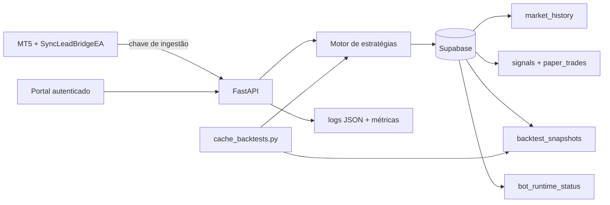

# Arquitetura operacional

## Princípios

- MT5/MQL5 executa coleta e, futuramente, ordens; Python decide e audita.
- As famílias V1/V2/V3 e a combinação V3 permanecem em shadow e falham fechadas.
- OHLCV pertence ao mercado, não ao catálogo de estratégias.
- Replays são causais, versionados e produzidos fora das requisições web.
- Supabase usa RLS sem privilégios para `anon` ou `authenticated`; somente o backend usa service role.

## Componentes e fluxo

O EA consulta `core-zigzag-v3`, `core-stochastic-v3`, `core-multitimeframe-v3` e
`core-combined-v3`. A decisão grava o histórico canônico por símbolo/timeframe, avança paper trades e atualiza o heartbeat operacional.
Cada chamada carrega `request_id` como chave de correlação. Respostas concluídas são persistidas por
`bot_id + request_id`, tornando retries posteriores idempotentes.

O executor MQL5 atual aceita uma única decisão por consulta. Portanto, a combinação V3, que retorna
`parallel_candidates`, ainda não deve ser escolhida em `ExecutionBotId`. Também não se deve executar
simultaneamente a combinação e as três estratégias individuais, pois isso duplicaria exposição.

## Persistência

| Tabela | Responsabilidade |
|---|---|
| `bots` | catálogo ativo das famílias ZigZag, Stochastic, Multitemporal e combinado |
| `market_history` | OHLCV canônico por mercado e timestamp |
| `market_ticks` | Bid/Ask bruto por broker e milissegundo para pesquisa shadow |
| `strategy_signals` | candidatos deduplicados e resposta do motor |
| `paper_trades` | acompanhamento técnico em shadow |
| `trade_results` | negócios encerrados reportados pelo MT5 |
| `backtest_snapshots` | replay compacto, versão e fingerprint das configurações |
| `bot_runtime_status` | último heartbeat, candle, resposta e latência |
| `decision_requests` | resposta final por requisição, usada para auditoria e idempotência |

## Portal

- `/bots`: catálogo e curvas anuais.
- `/compare`: resultados shadow lado a lado.
- `/bots/{id}`: replay e eventos da estratégia.
- `/growth-simulator`: risco fixo ou faixas permanentes de redução.
- `/operations`: heartbeat, atraso de mercado e validade dos snapshots.
- `/health`: liveness do processo; não consulta dependências.
- `/ready`: readiness da configuração e do Supabase.
- `/api/metrics`: contadores e latências agregadas, disponível somente com sessão.

## Segurança e operação

Dashboard e APIs de leitura exigem cookie assinado. Decisão e ingestão usam uma chave separada em header. `/health` é público e não expõe configuração; `/config` exige sessão. Execução continua bloqueada por flags no Python, trava experimental dos perfis e `EnableOrderExecution=false` no EA.
Login e ingestão têm limites por processo. Operações autenticadas rejeitam origens cruzadas. O portal
escapa valores dinâmicos antes de inseri-los em HTML e envia uma política CSP restritiva.

Os logs de decisão são JSON e usam `request_id`, etapa, estado, duração e código de erro normalizado.
Credenciais e payloads completos não são registrados. As métricas em memória são por instância; a
agregação entre instâncias deve ser feita pelo coletor de telemetria da plataforma.

## Registro de estratégias

Os metadados estruturais dos perfis ativos ficam centralizados em
`python-service/app/strategies/registry.py`. Roteamento, família visual, ordem no portal, profundidade
histórica, política de regime e seleção operacional derivam desse registro. O catálogo JSON mantém
somente o conteúdo público. Consulte `strategy-registry.md` para o contrato de inclusão de perfis.

## Serviços de aplicação

As rotas HTTP delegam políticas sem estado web para `python-service/app/services`. Comparação de
equity está em `comparison.py`; carregamento, fallback, recorte e enriquecimento dos replays estão
em `replays.py`; classificação de saúde operacional e conexão da conta está em `runtime.py`. Os
wrappers temporários de `main.py` preservam a API interna durante a migração gradual para routers
menores.

As páginas HTML autenticadas são registradas por `python-service/app/routers/portal.py`. O router
recebe catálogo, resolução de bots e guarda de sessão por injeção, evitando dependência circular
com `main.py`. Comparação histórica, gráfico de mercado e replay individual são registrados por
`python-service/app/routers/replays.py`, mantendo as APIs JSON separadas das páginas.
Trades, candles e ticks entram pelas rotas agrupadas em `python-service/app/routers/ingestion.py`;
as funções de compatibilidade em `main.py` ainda aplicam chave, limites e regras de persistência.
Liveness, readiness, métricas, configuração, conta e operações são publicados por
`python-service/app/routers/operational.py`, mantendo o contrato de observabilidade separado da
decisão e da ingestão.
O endpoint `/decision` é registrado por `python-service/app/routers/decision.py`; o controlador
compatível em `main.py` ainda concentra o fluxo transacional até que suas etapas sejam extraídas
para um serviço de aplicação.
As regras de escopo de símbolo/timeframe e o bloqueio por amostra mínima de paper trades já foram
extraídas para `python-service/app/services/decision_context.py`; persistência e telemetria ainda
permanecem transacionais no controlador durante esta migração.

## Fronteiras atuais entre repositórios

O pipeline de mercado ainda vive neste repositório e publica em `/home/codexops/lotus-data`. O
Live Core é mantido no repositório `2lotus-live-core` (diretório local histórico `1lotus`). O antigo
`3lotus` tornou-se o site `institucional-2lotus` e não é dependência operacional.

Essa fronteira ainda não corresponde integralmente ao deploy: o serviço `2lotus` hospeda hoje o
Live Core e a conta demo existente, enquanto o serviço dedicado `live-core` está ocioso. O destino
planejado é `2lotus = demo/laboratório` e `live-core = conta real/execução protegida`.

Consulte `current-state.md` para o inventário validado e `PRD-improvements.md` para a separação
planejada das responsabilidades.
