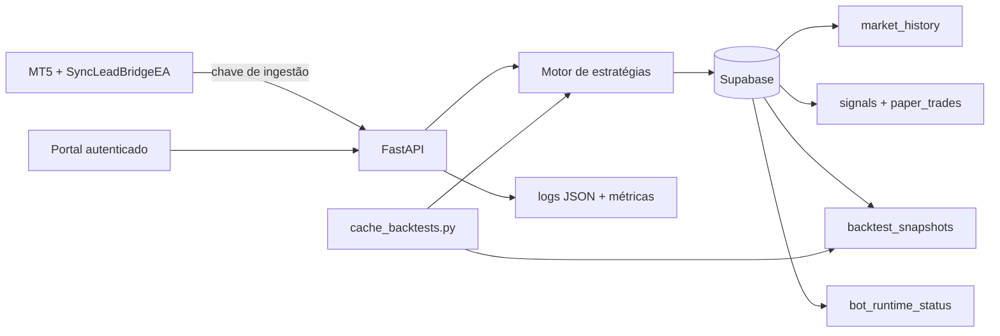

# Arquitetura operacional

## Princípios

- MT5/MQL5 executa coleta e, futuramente, ordens; Python decide e audita.
- Todas as seis estratégias permanecem em shadow e falham fechadas.
- OHLCV pertence ao mercado, não ao catálogo de estratégias.
- Replays são causais, versionados e produzidos fora das requisições web.
- Supabase usa RLS sem privilégios para `anon` ou `authenticated`; somente o backend usa service role.

## Componentes e fluxo

O EA consulta apenas `bot-6`, `bot-7`, `bot-11`, `bot-12`, `bot-13` e `bot-16`. A decisão grava o histórico canônico por símbolo/timeframe, avança paper trades e atualiza o heartbeat operacional.
Cada chamada carrega `request_id` como chave de correlação. Respostas concluídas são persistidas por
`bot_id + request_id`, tornando retries posteriores idempotentes.

## Persistência

| Tabela | Responsabilidade |
|---|---|
| `bots` | seis perfis selecionados e seus textos públicos |
| `market_history` | OHLCV canônico por mercado e timestamp |
| `market_ticks` | Bid/Ask bruto por broker e milissegundo para pesquisa shadow |
| `strategy_signals` | candidatos deduplicados e resposta do motor |
| `paper_trades` | acompanhamento técnico em shadow |
| `trade_results` | negócios encerrados reportados pelo MT5 |
| `backtest_snapshots` | replay compacto, versão e fingerprint das configurações |
| `bot_runtime_status` | último heartbeat, candle, resposta e latência |
| `decision_requests` | resposta final por requisição, usada para auditoria e idempotência |

## Portal

- `/bots`: catálogo e curvas anuais.
- `/compare`: resultados shadow lado a lado.
- `/bots/{id}`: replay e eventos da estratégia.
- `/growth-simulator`: risco fixo ou faixas permanentes de redução.
- `/operations`: heartbeat, atraso de mercado e validade dos snapshots.
- `/health`: liveness do processo; não consulta dependências.
- `/ready`: readiness da configuração e do Supabase.
- `/api/metrics`: contadores e latências agregadas, disponível somente com sessão.

## Segurança e operação

Dashboard e APIs de leitura exigem cookie assinado. Decisão e ingestão usam uma chave separada em header. `/health` é público e não expõe configuração; `/config` exige sessão. Execução continua bloqueada por flags no Python, trava experimental dos perfis e `EnableOrderExecution=false` no EA.
Login e ingestão têm limites por processo. Operações autenticadas rejeitam origens cruzadas. O portal
escapa valores dinâmicos antes de inseri-los em HTML e envia uma política CSP restritiva.

Os logs de decisão são JSON e usam `request_id`, etapa, estado, duração e código de erro normalizado.
Credenciais e payloads completos não são registrados. As métricas em memória são por instância; a
agregação entre instâncias deve ser feita pelo coletor de telemetria da plataforma.
